<h3><code>shreyanshj10@github ~ $ whoami</code></h3>

  

<h3><code>shreyanshj10@github ~ $ merged --by-repo</code></h3>

 

# Shreyansh Jain

AI engineer. I work on agent systems, LLM tooling and the plumbing underneath them — streaming
parsers, request translation between provider schemas, query generation, caching paths.

Most of what I enjoy is one shape of problem: a value that is correct on one code path and quietly
wrong on the one beside it. Below is where that has turned into upstream work.

## Merged

18 merged pull requests across 13 repositories.

| Repository | Stars | PRs | Contribution |
|---|---:|---:|---|
| [langgenius/dify](https://github.com/langgenius/dify) | 158.5k | 1 | [#44005](https://github.com/langgenius/dify/pull/44005) — skip the reasoning JSON when selecting structured output. A reasoning model emits JSON inside its chain of thought, and the selector took the first object it found, so the answer was whatever the model had been thinking aloud about |
| [vllm-project/vllm](https://github.com/vllm-project/vllm) | 93.8k | 1 | [#60359](https://github.com/vllm-project/vllm/pull/60359) — reject regex the outlines backend cannot compile. The validator walked the parse tree but only recursed into two node types, so `\b` and backreferences slipped through inside groups, possessive repeats and atomic groups |
| [virgiliojr94/book-to-skill](https://github.com/virgiliojr94/book-to-skill) | 34.7k | 1 | [#250](https://github.com/virgiliojr94/book-to-skill/pull/250) — strip Default_Ignorable invisible carriers during sanitisation |
| [oraios/serena](https://github.com/oraios/serena) | 30.3k | 1 | [#2143](https://github.com/oraios/serena/pull/2143) — stop running a scanned project's own `tsserver`. The toolkit indexes repositories it does not trust, so the TypeScript server is now pinned to the one it installed itself |
| [maximhq/bifrost](https://github.com/maximhq/bifrost) | 8.7k | 2 | [#8208](https://github.com/maximhq/bifrost/pull/8208) map `output_text` to `text` on multi-part assistant turns · [#8209](https://github.com/maximhq/bifrost/pull/8209) keep the failed tool-result marker on the OpenAI Responses wire |
| [lingdojo/kana-dojo](https://github.com/lingdojo/kana-dojo) | 3.6k | 1 | [#30170](https://github.com/lingdojo/kana-dojo/pull/30170) — add a new common-mistake entry |
| [spec-kitty/spec-kitty](https://github.com/spec-kitty/spec-kitty) | 1.7k | 1 | [#4798](https://github.com/spec-kitty/spec-kitty/pull/4798) — label query-mode preflight failures by consumer |
| [sipyourdrink-ltd/bernstein](https://github.com/sipyourdrink-ltd/bernstein) | 1.2k | 1 | [#6056](https://github.com/sipyourdrink-ltd/bernstein/pull/6056) — report a crashed test file by its exit status |
| [vikdevelop/SaveDesktop](https://github.com/vikdevelop/SaveDesktop) | 819 | 1 | [#555](https://github.com/vikdevelop/SaveDesktop/pull/555) — fix saving when a cached workspace path is a file, and recover installs already left that way |
| [zostera/django-bootstrap5](https://github.com/zostera/django-bootstrap5) | 452 | 5 | [#879](https://github.com/zostera/django-bootstrap5/pull/879) `show_label` on `bootstrap_label` · [#881](https://github.com/zostera/django-bootstrap5/pull/881) accept a lazy `static()` value · [#880](https://github.com/zostera/django-bootstrap5/pull/880) keep a widget template set on a subclass · [#876](https://github.com/zostera/django-bootstrap5/pull/876) add-ons on floating-label fields · [#873](https://github.com/zostera/django-bootstrap5/pull/873) recognise `color`/`week`/`search` inputs |
| [PicPeak/picpeak](https://github.com/PicPeak/picpeak) | 334 | 1 | [#1417](https://github.com/PicPeak/picpeak/pull/1417) — regenerate missing thumbnails for already-uploaded videos |
| [haddocking/haddock3](https://github.com/haddocking/haddock3) | 276 | 1 | [#1712](https://github.com/haddocking/haddock3/pull/1712) — remove two sialylation loops that could never fire |
| [mkbhardwas12/pwned-deps](https://github.com/mkbhardwas12/pwned-deps) | 164 | 1 | [#15](https://github.com/mkbhardwas12/pwned-deps/pull/15) — scan CycloneDX and SPDX documents as check input |

## Open, under review

27 pull requests awaiting review, including:

| Repository | Stars | PRs | Contribution |
|---|---:|---:|---|
| [NousResearch/hermes-agent](https://github.com/NousResearch/hermes-agent) | 253.7k | 1 | stale caller-root handling in the Windows desktop update verifier |
| [anomalyco/opencode](https://github.com/anomalyco/opencode) | 213.4k | 2 | re-read the Home session index on its staleness window, so sessions created by a second server on the same database appear; and support the LaTeX control space, which made a whole math fence print its raw source |
| [github/spec-kit](https://github.com/github/spec-kit) | 141.2k | 1 | resolve the hook invocation prefix per agent, so a generated Codex skill stops telling you to run a command Codex cannot parse |
| [vllm-project/vllm](https://github.com/vllm-project/vllm) | 93.8k | 3 | streaming tool-parser fixes — xLAM nested arguments, and DeepSeek-V3 arguments pretty-printed over several lines; and a KV-offload fs tier that failed a whole batch when another engine instance had already published the same content-hashed block |
| [stablyai/orca](https://github.com/stablyai/orca) | 92.2k | 1 | index agent sessions on Windows — the scanner built its root from a Unix-only home path with no platform branch |
| [storybookjs/storybook](https://github.com/storybookjs/storybook) | 91.3k | 1 | admit the `id` prop the indexer already reads, on the docs `Meta` block |
| [BerriAI/litellm](https://github.com/BerriAI/litellm) | 61.2k | 2 | scan the call types the proxy really sends for prompt injection, and return 400 on a malformed Anthropic `tool_choice` |
| [rclone/rclone](https://github.com/rclone/rclone) | 60.3k | 1 | fix a crash renaming a directory while the dir cache expires — the parent's map was written under the child's lock |
| [drizzle-team/drizzle-orm](https://github.com/drizzle-team/drizzle-orm) | 36.0k | 1 | scope the MySQL check-constraint introspection join to its schema |
| [huggingface/lerobot](https://github.com/huggingface/lerobot) | 28.2k | 1 | drive the reBot B601 follower arm to a safe home position when the teleoperation link drops, instead of leaving it holding its last commanded pose |
| [PipedreamHQ/pipedream](https://github.com/PipedreamHQ/pipedream) | 11.7k | 1 | correct the Google Business Profile review action schemas, and page through results instead of returning only the first page |
| [share/sharedb](https://github.com/share/sharedb) | 6.5k | 1 | validate ids and versions on the bulk and query-reconnect paths |
| [ansible-collections/community.general](https://github.com/ansible-collections/community.general) | 1.1k | 1 | close `pkg(8)`'s stdin so it takes defaults instead of hanging |
| [zostera/django-modeltrans](https://github.com/zostera/django-modeltrans) | 80 | 8 | expression fallback, per-lookup annotations, lazy language resolution, `distinct()` support, type-checker resolution |

## Stack

Python · TypeScript · Go · Java · Django · PyTorch · pytest · vitest · PostgreSQL · Docker
