<!-- Every image here is generated into this repo and committed, so nothing is fetched from a
     third-party stats service that can rate-limit or go dark.
       cards + banner : python scripts/profile_art.py        (reads the contribution ledger)
     Each writes a -dark and a -light variant; <picture> picks by prefers-color-scheme.
     Motion is SMIL inside each SVG, because GitHub strips <script> and inline CSS. -->

<picture>
  <source media="(prefers-color-scheme: dark)" srcset="./name-banner-dark.svg">
  
</picture>

<b>Fullstack Developer · AI Builder · Agentic Systems</b>

[-b35900?style=for-the-badge&logo=shield&logoColor=white)](https://github.com/share/sharedb/security/advisories/GHSA-94fr-2wj7-v4vj)

 

<picture>
  <source media="(prefers-color-scheme: dark)" srcset="./profile-card-dark.svg">
  
</picture>

 

<picture>
  <source media="(prefers-color-scheme: dark)" srcset="./merged-ladder-dark.svg">
  
</picture>

 

## About

AI engineer. I work on agent systems, LLM tooling and the plumbing underneath them — streaming
parsers, request translation between provider schemas, query generation, caching paths.

Most of what I enjoy is one shape of problem: a value that is correct on one code path and quietly
wrong on the one beside it. Below is where that has turned into upstream work.

**Security.** `GHSA-94fr-2wj7-v4vj` (high) — ShareDB's agent accepted request fields it never
type-checked, so a client could send `{"toString": 1}` and crash the server process with an
uncaught `TypeError` inside database and pub/sub callbacks. I am the credited remediation
developer; the fix shipped in
[ShareDB v7.0.0](https://github.com/share/sharedb/releases/tag/v7.0.0).

**I take on freelance work.** Python and Django, agent and LLM tooling, or ongoing maintenance on
a codebase you would rather hand to someone who reads it before changing it. Small, tested changes
are what I am best at — the pull requests below are the sample. Email is the quickest way to reach
me: [shreyanshjain646@gmail.com](mailto:shreyanshjain646@gmail.com).

## Merged

<b>42 merged pull requests across 32 repositories</b> — open for the list

| Repository | Stars | PRs | Contribution |
|---|---:|---:|---|
| [nilbuild/developer-roadmap](https://github.com/nilbuild/developer-roadmap) | 372.3k | 1 | [#10589](https://github.com/nilbuild/developer-roadmap/pull/10589) — drop four dead article links from the DevRel roadmap content |
| [langgenius/dify](https://github.com/langgenius/dify) | 161.2k | 1 | [#44005](https://github.com/langgenius/dify/pull/44005) — skip the reasoning JSON when selecting structured output. A reasoning model emits JSON inside its chain of thought, and the selector took the first object it found, so the answer was whatever the model had been thinking aloud about |
| [vllm-project/vllm](https://github.com/vllm-project/vllm) | 97.0k | 2 | [#61390](https://github.com/vllm-project/vllm/pull/61390) treat an already-published fs block as stored, so a KV-offload tier stops failing a whole batch when another engine instance published the same content-hashed block first — [#60359](https://github.com/vllm-project/vllm/pull/60359) reject regex the outlines backend cannot compile. The validator walked the parse tree but only recursed into two node types, so `\b` and backreferences slipped through inside groups, possessive repeats and atomic groups |
| [shareAI-lab/learn-claude-code](https://github.com/shareAI-lab/learn-claude-code) | 80.5k | 1 | [#613](https://github.com/shareAI-lab/learn-claude-code/pull/613) — keep the tool input from overriding the MCP handler's own tool name, so a call routed through the handler stops being dispatched under whatever name the arguments happened to carry |
| [rclone/rclone](https://github.com/rclone/rclone) | 61.0k | 1 | [#10081](https://github.com/rclone/rclone/pull/10081) — fix a crash when a directory is renamed while the dir cache expires: the parent's map was written under the child's lock. Merged by rclone's author |
| [go-gitea/gitea](https://github.com/go-gitea/gitea) | 59.1k | 1 | [#40073](https://github.com/go-gitea/gitea/pull/40073) — a push to the default branch discarded an Actions schedule that was already due, so a cron workflow could silently skip its run |
| [k88hudson/git-flight-rules](https://github.com/k88hudson/git-flight-rules) | 42.6k | 2 | [#388](https://github.com/k88hudson/git-flight-rules/pull/388) document how to drop a file from the previous commit without losing the change — [#389](https://github.com/k88hudson/git-flight-rules/pull/389) stop presenting hosting access control as a limitation of Git itself |
| [virgiliojr94/book-to-skill](https://github.com/virgiliojr94/book-to-skill) | 38.0k | 1 | [#250](https://github.com/virgiliojr94/book-to-skill/pull/250) — strip Default_Ignorable invisible carriers during sanitisation |
| [jaywcjlove/linux-command](https://github.com/jaywcjlove/linux-command) | 37.2k | 1 | [#716](https://github.com/jaywcjlove/linux-command/pull/716) — add a page for `lsscsi`, which the index listed but never documented |
| [mantinedev/mantine](https://github.com/mantinedev/mantine) | 32.0k | 2 | [#9376](https://github.com/mantinedev/mantine/pull/9376) keep `aria-pressed` on the tiptap toggle controls, so a screen reader can still tell whether bold or italic is active — [#9441](https://github.com/mantinedev/mantine/pull/9441) stop `use-radial-move`'s `normalizeRadialValue` rounding up instead of to the nearest step |
| [oraios/serena](https://github.com/oraios/serena) | 31.4k | 1 | [#2143](https://github.com/oraios/serena/pull/2143) — stop running a scanned project's own `tsserver`. The toolkit indexes repositories it does not trust, so the TypeScript server is now pinned to the one it installed itself |
| [academic/awesome-datascience](https://github.com/academic/awesome-datascience) | 30.3k | 1 | [#766](https://github.com/academic/awesome-datascience/pull/766) — repoint two dead links whose hosts had gone |
| [knadh/listmonk](https://github.com/knadh/listmonk) | 24.4k | 1 | [#3361](https://github.com/knadh/listmonk/pull/3361) — let the admin editor handle only its own `input` event, instead of reacting to every one that bubbles up from a child |
| [copy/v86](https://github.com/copy/v86) | 23.7k | 1 | [#1673](https://github.com/copy/v86/pull/1673) — send cols before rows in the virtio-console resize control message, matching the order the spec defines |
| [fyne-io/fyne](https://github.com/fyne-io/fyne) | 28.8k | 1 | [#6652](https://github.com/fyne-io/fyne/pull/6652) — keep the trailing space of a word-wrapped line inside its own row, instead of giving it a row of its own and shifting everything below it |
| [simple-icons/simple-icons](https://github.com/simple-icons/simple-icons) | 26.2k | 1 | [#15179](https://github.com/simple-icons/simple-icons/pull/15179) — update the Marko icon and its brand colour to match the mark and hex Marko now publishes |
| [tayllan/awesome-algorithms](https://github.com/tayllan/awesome-algorithms) | 25.7k | 1 | [#1189](https://github.com/tayllan/awesome-algorithms/pull/1189) — repoint the dead link to Rice University's data-structures cheat sheet |
| [lima-vm/lima](https://github.com/lima-vm/lima) | 22.4k | 1 | [#5782](https://github.com/lima-vm/lima/pull/5782) — document the minimal example for disabling port forwarding; the snippet the docs shipped still forwarded `127.0.0.1` |
| [postcss/autoprefixer](https://github.com/postcss/autoprefixer) | 22.2k | 1 | [#1567](https://github.com/postcss/autoprefixer/pull/1567) — document the `--env` flag the CLI already accepted. Merged by Andrey Sitnik |
| [eclipse-theia/theia](https://github.com/eclipse-theia/theia) | 21.8k | 1 | [#18307](https://github.com/eclipse-theia/theia/pull/18307) — stop publishing ambient `const enum`s in the shipped `.d.ts` files, which made them unusable from any consumer built with `isolatedModules` or a per-file transpiler |
| [maximhq/bifrost](https://github.com/maximhq/bifrost) | 9.6k | 2 | [#8208](https://github.com/maximhq/bifrost/pull/8208) map `output_text` to `text` on multi-part assistant turns — [#8209](https://github.com/maximhq/bifrost/pull/8209) keep the failed tool-result marker on the OpenAI Responses wire |
| [lingdojo/kana-dojo](https://github.com/lingdojo/kana-dojo) | 3.9k | 1 | [#30170](https://github.com/lingdojo/kana-dojo/pull/30170) — add a new common-mistake entry |
| [spec-kitty/spec-kitty](https://github.com/spec-kitty/spec-kitty) | 1.7k | 1 | [#4798](https://github.com/spec-kitty/spec-kitty/pull/4798) — label query-mode preflight failures by consumer |
| [sipyourdrink-ltd/bernstein](https://github.com/sipyourdrink-ltd/bernstein) | 1.2k | 1 | [#6056](https://github.com/sipyourdrink-ltd/bernstein/pull/6056) — report a crashed test file by its exit status |
| [ansible-collections/community.general](https://github.com/ansible-collections/community.general) | 1.1k | 1 | [#12898](https://github.com/ansible-collections/community.general/pull/12898) — close `pkg(8)`'s stdin so interactive prompts take their defaults instead of hanging the task |
| [vikdevelop/SaveDesktop](https://github.com/vikdevelop/SaveDesktop) | 826 | 1 | [#555](https://github.com/vikdevelop/SaveDesktop/pull/555) — fix saving when a cached workspace path is a file, and recover installs already left that way |
| [zostera/django-bootstrap5](https://github.com/zostera/django-bootstrap5) | 452 | 5 | [#879](https://github.com/zostera/django-bootstrap5/pull/879) `show_label` on `bootstrap_label` — [#881](https://github.com/zostera/django-bootstrap5/pull/881) accept a lazy `static()` value — [#880](https://github.com/zostera/django-bootstrap5/pull/880) keep a widget template set on a subclass — [#876](https://github.com/zostera/django-bootstrap5/pull/876) add-ons on floating-label fields — [#873](https://github.com/zostera/django-bootstrap5/pull/873) recognise `color`/`week`/`search` inputs |
| [PicPeak/picpeak](https://github.com/PicPeak/picpeak) | 368 | 1 | [#1417](https://github.com/PicPeak/picpeak/pull/1417) — regenerate missing thumbnails for already-uploaded videos |
| [haddocking/haddock3](https://github.com/haddocking/haddock3) | 284 | 1 | [#1712](https://github.com/haddocking/haddock3/pull/1712) — remove two sialylation loops that could never fire |
| [mkbhardwas12/pwned-deps](https://github.com/mkbhardwas12/pwned-deps) | 164 | 1 | [#15](https://github.com/mkbhardwas12/pwned-deps/pull/15) — scan CycloneDX and SPDX documents as check input |
| [zostera/django-modeltrans](https://github.com/zostera/django-modeltrans) | 80 | 1 | [#148](https://github.com/zostera/django-modeltrans/pull/148) — fall back to the base field when a translation is stored as an empty string, instead of rendering a blank value |
| [0101Harshit/web-chat-assistant](https://github.com/0101Harshit/web-chat-assistant) | — | 3 | earlier project work: [#1](https://github.com/0101Harshit/web-chat-assistant/pull/1) an embeddable Web Component chat widget — [#2](https://github.com/0101Harshit/web-chat-assistant/pull/2) backend project setup — [#3](https://github.com/0101Harshit/web-chat-assistant/pull/3) the WebSocket transport |

Also shipped, though not as one of mine: the LaTeX control-space fix in [anomalyco/opencode](https://github.com/anomalyco/opencode) (227k stars). Their cleanup bot closes pull requests over a month old with fewer than two reactions, and mine ([#55359](https://github.com/anomalyco/opencode/pull/55359)) went with it while it waited for review. A contributor resubmitted the two commits unchanged as [#64156](https://github.com/anomalyco/opencode/pull/64156) — a bot-closed PR can only be reopened from the original fork — and it squash-merged into `dev` as `4cf9db95` with co-author credit, shipping in v2.4.1.

## Open, under review

<b>46 pull requests awaiting review across 32 repositories</b> — open for the list

| Repository | Stars | PRs | Contribution |
|---|---:|---:|---|
| [NousResearch/hermes-agent](https://github.com/NousResearch/hermes-agent) | 265.8k | 1 | stale caller-root handling in the Windows desktop update verifier |
| [react/react](https://github.com/react/react) | 252.8k | 1 | clear the lane on an update that bailed out eagerly, so later work does not inherit it |
| [github/spec-kit](https://github.com/github/spec-kit) | 151.2k | 1 | resolve the hook invocation prefix per agent, so a generated Codex skill stops telling you to run a command Codex cannot parse |
| [react/react-native](https://github.com/react/react-native) | 127.0k | 1 | run RNTester's iOS unit tests in the CI job meant to cover them |
| [hacksider/Deep-Live-Cam](https://github.com/hacksider/Deep-Live-Cam) | 98.9k | 3 | always convert frames to RGB for the NSFW check — keep the face enhancer on when transparency reaches 0% — honour rotation metadata in the in-memory video pipeline |
| [vllm-project/vllm](https://github.com/vllm-project/vllm) | 97.5k | 1 | xLAM streaming tool-parser fix for deeply nested arguments |
| [storybookjs/storybook](https://github.com/storybookjs/storybook) | 91.7k | 1 | admit the `id` prop the indexer already reads, on the docs `Meta` block |
| [elastic/elasticsearch](https://github.com/elastic/elasticsearch) | 78.7k | 2 | fix bool column promotion past the end of the value bitset, and stop an empty-named object merging into its parent in ESCF |
| [byoungd/up](https://github.com/byoungd/up) | 70.8k | 1 | ignore inline code spans when extracting external links, so a documented example stops being link-checked |
| [labmlai/annotated_deep_learning_paper_implementations](https://github.com/labmlai/annotated_deep_learning_paper_implementations) | 67.8k | 1 | restore the missing negative sign in the RoPE theta formula |
| [BerriAI/litellm](https://github.com/BerriAI/litellm) | 63.8k | 2 | scan the call types the proxy really sends for prompt injection, and return 400 on a malformed Anthropic `tool_choice` |
| [router-for-me/CLIProxyAPI](https://github.com/router-for-me/CLIProxyAPI) | 59.4k | 3 | keep tool arguments for implicitly open object schemas — keep the stricter constraint when a `$ref` sibling repeats a keyword — report `promptFeedback` prompt blocks as stream errors |
| [wagoodman/dive](https://github.com/wagoodman/dive) | 54.8k | 1 | document the Ctrl+Space conflict with OS input-method switching |
| [charlax/professional-programming](https://github.com/charlax/professional-programming) | 51.7k | 1 | add ETH Zurich's Computer Architecture course |
| [slidevjs/slidev](https://github.com/slidevjs/slidev) | 49.6k | 2 | add a `defineViteConfig` helper so `vite.config.ts` type-checks against the Slidev augmentation, and warn WebKit users that in-browser PDF export will not match the slides |
| [meteor/meteor](https://github.com/meteor/meteor) | 44.8k | 2 | require a value for the `list_package_changes.sh` options, and explain the v3 email behaviour when settings are missing |
| [glanceapp/glance](https://github.com/glanceapp/glance) | 38.4k | 1 | handle feed dates that write midnight as hour 24 |
| [koajs/koa](https://github.com/koajs/koa) | 35.7k | 1 | normalise the request host when `back()` checks the referrer |
| [python-poetry/poetry](https://github.com/python-poetry/poetry) | 34.3k | 1 | reject package versions carrying uninterpretable requirement markers |
| [oraios/serena](https://github.com/oraios/serena) | 31.7k | 1 | wait for FsAutoComplete's workspace load before answering F# requests |
| [XIU2/CloudflareSpeedTest](https://github.com/XIU2/CloudflareSpeedTest) | 30.2k | 1 | document that `go install` cannot install the v2.x.x line |
| [google-labs-code/design.md](https://github.com/google-labs-code/design.md) | 29.1k | 1 | correct unitless `hsl`/`hwb` parsing and percentage scaling across the lab family |
| [huggingface/lerobot](https://github.com/huggingface/lerobot) | 29.1k | 1 | drive the reBot B601 follower arm to a safe home position when the teleoperation link drops, instead of leaving it holding its last commanded pose |
| [anomalyco/sst](https://github.com/anomalyco/sst) | 26.5k | 1 | restore junction resolution on Windows so `sst dev` rebuilds workspace packages |
| [simple-icons/simple-icons](https://github.com/simple-icons/simple-icons) | 26.3k | 1 | add the Vega-Altair icon |
| [lima-vm/lima](https://github.com/lima-vm/lima) | 22.5k | 1 | truncate the response body in an HTTP status error, so a 64 KiB HTML error page stops being pasted whole into the message |
| [avajs/ava](https://github.com/avajs/ava) | 20.8k | 1 | add a `tempDir` configuration option |
| [PipedreamHQ/pipedream](https://github.com/PipedreamHQ/pipedream) | 11.8k | 1 | correct the Google Business Profile review action schemas, and page through results instead of returning only the first page |
| [mmcdole/gofeed](https://github.com/mmcdole/gofeed) | 2.9k | 1 | parse dates whose hour is 24 as the start of the next day — filed upstream where the glance maintainer asked for it |
| [zostera/django-bootstrap5](https://github.com/zostera/django-bootstrap5) | 452 | 1 | `wrapper=False` to render a field without its wrapper |
| [mkbhardwas12/pwned-deps](https://github.com/mkbhardwas12/pwned-deps) | 163 | 1 | support NuGet `packages.lock.json` lockfiles |
| [zostera/django-modeltrans](https://github.com/zostera/django-modeltrans) | 80 | 7 | expression fallback, per-lookup i18n annotations, a clearer error for unsupported queries, active-language resolution, `distinct()` support, and type-checker resolution of the manager |

## Stack

Python · TypeScript · Go · Java · Django · PyTorch · pytest · vitest · PostgreSQL · Docker
